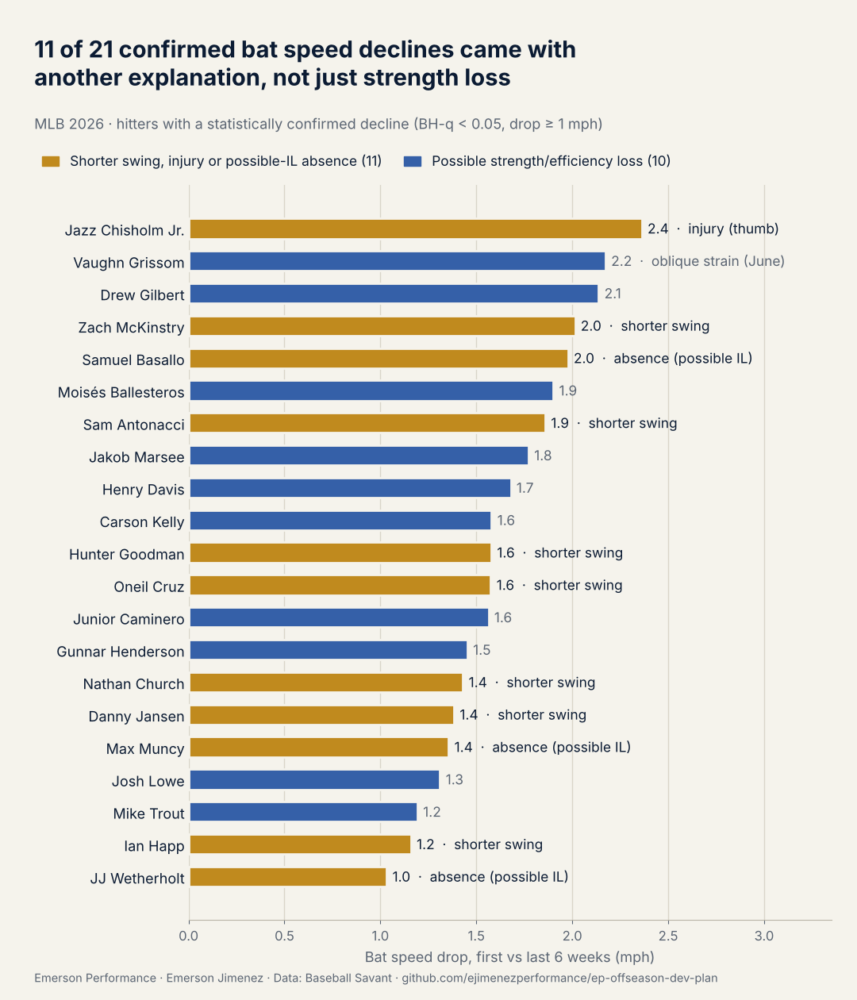
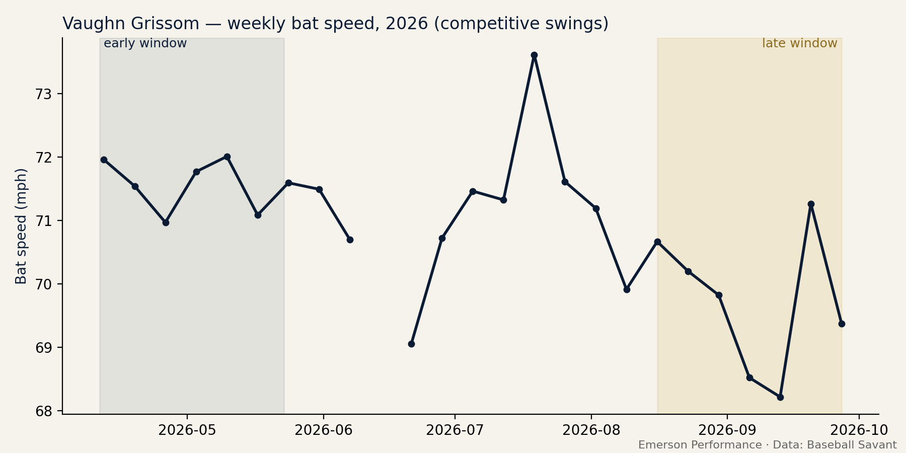

# EP Offseason Development Plan

## Half of the biggest 2026 bat speed declines came with a shorter swing, an injury or an IL-length absence — not just strength loss.
*La mitad de las mayores caídas de bat speed de 2026 vinieron con un swing más corto, una lesión o una ausencia — no solo pérdida de fuerza.*

Emerson Performance (EP) · Emerson Jimenez · Data: Baseball Savant

---

## Key findings / Hallazgos clave

**1. 21 MLB hitters had a statistically confirmed bat speed decline in 2026** (first vs last 6 weeks, corrected for testing the whole league). **11 of them (52%) came with another likely explanation besides strength loss:**
*21 bateadores tuvieron una caída confirmada. **11 (52%) vinieron con otra explicación probable además de la fuerza:***

| Cause / Causa | n |
|---|---|
| Clearly shorter swing (swing or approach change) / *Swing claramente más corto* | 7 |
| Absence of 14+ days (possible IL) / *Ausencia de 14+ días (posible IL)* | 3 |
| Known injury in the late window / *Lesión conocida en la ventana final* | 1 |
| Possible force loss, with earlier injury / *Posible fuerza, con lesión previa* | 1 |
| Possible force/efficiency loss, no other explanation found / *Posible fuerza, sin otra explicación* | 9 |



→ Full table by hitter, with sources: [`output/decline_causes_summary.md`](output/decline_causes_summary.md)

**2. Small natural rebound in the decliners.** The 21 hitters with a confirmed decline in 2025 recovered a median of only **+0.1 mph** by early 2026 (league-adjusted). This sets the success threshold for an offseason plan. It is a small-sample result for that group only; see finding 4 for the league-wide picture.
*Recuperación natural pequeña en los que cayeron: los 21 bateadores con caída en 2025 recuperaron apenas +0.1 mph al inicio de 2026. Define el umbral de éxito del plan. Es una muestra pequeña de ese grupo; ver el hallazgo 4 para la liga completa.*

**3. Application case: Vaughn Grissom.** Bat speed fell **2.2 mph** (71.7 → 69.5) with a progressive decline, in a season that included an oblique strain (IL, early June). His plan rebuilds rotation progressively (anti-rotation → controlled rotation → ballistic) and counts as successful only if recovery exceeds **+0.6 mph**.
*Caso de aplicación: Grissom perdió 2.2 mph, en una temporada con distensión de oblicuo. Su plan reconstruye la rotación de forma progresiva y solo es éxito si recupera más de +0.6 mph.*



→ Full plan: [`output/vaughn-grissom_offseason_plan.md`](output/vaughn-grissom_offseason_plan.md)

**4. For projection, don't overreact to September.** Across **225 hitters** (2025 → 2026), bat speed in the last 6 weeks did **not** predict next season better than the full-season mean — `NOT CONFIRMED` (null result).

| Target (2026) | Full-season mean, LOO MAE | Last 6 weeks, LOO MAE | Difference, 95% CI |
|---|---|---|---|
| First 6 weeks | 0.755 mph | 0.786 mph | −0.031 [−0.086, +0.023] |
| Full season | 0.712 mph | 0.769 mph | −0.056 [−0.112, +0.000] |

For the full season the difference leans toward the full-season mean, right at the edge of significance. Adding the late window to the full-season mean barely helps (0.709 vs 0.712). **Takeaway for projection: the full-season mean remains the better reference; a late-season drop alone is not a reason to lower next year's bat speed expectation.** Why the 21 decliners recovered little while the league-wide test shows no carry-over is open: the late window has far fewer swings (noisier), and decliners are a small subset — `INTERPRETATION`, not tested.

*Para proyectar, no sobrerreaccionar a septiembre: en 225 bateadores, las últimas 6 semanas no predicen la temporada siguiente mejor que el promedio de toda la temporada (resultado nulo). El promedio de temporada sigue siendo la mejor referencia.*

→ Details: [`output/projection_summary.md`](output/projection_summary.md) — `python src/projection.py --prev data/statcast_2025.csv --next data/statcast_2026.csv`

---

## Why this repo / Por qué este repo

Most public analytics work stops at the finding. A player development staff has to answer the next question: *what do we do about it this offseason, and how will we know it worked?* This repo connects both sides — the data and the weight room — using the EP four-layer template. It also shows when the weight room is **not** the answer.

*La mayoría del análisis público termina en el hallazgo. Un staff de desarrollo tiene que responder qué hacer en la offseason y cómo saber si funcionó. Este repo une los datos y el gimnasio, y también muestra cuándo el gimnasio **no** es la respuesta.*

| Layer / Capa | What it does / Qué hace | File |
|---|---|---|
| 1. Data | Competitive swings, first 6 vs last 6 weeks of 2026 | `src/select_player.py` |
| 2. Finding | Mann-Whitney + Benjamini-Hochberg + Cohen's d → `CONFIRMED` / `NOT CONFIRMED` | `src/select_player.py` |
| 3. Biomechanics | Rule-based reading: **force**, **efficiency** or **swing change** profile, plus injury/absence filter → `INTERPRETATION` | `src/diagnose.py`, `src/run_pipeline.py` |
| 4. Training | 12-week block, emphasis changes by profile | `src/plan_builder.py` |
| 5. Monitoring | Required: bat sensor. Recommended: med ball, CMJ height. Optional: force-plate RFD. 2027 follow-up vs natural rebound threshold | `src/plan_builder.py`, `src/natural_rebound.py` |

## Method / Método

- **Competitive swings / Swings competitivos:** each hitter's slowest 10% removed, swings ≥ 60 mph always kept (Baseball Savant–style filter).
- **Windows / Ventanas:** first 6 weeks vs last 6 weeks of the season; minimum 75 competitive swings in each.
- **Test:** one-sided Mann-Whitney U (early > late), corrected with **Benjamini-Hochberg** because the whole league is tested at once. `CONFIRMED` requires BH-q < 0.05 **and** a drop ≥ 1.0 mph (statistical *and* practical significance).
- **Profile rule / Regla de perfil:**
  - Swing length up ≥ 0.2 ft while bat speed falls → **efficiency** (sequencing / energy transfer).
  - Swing length down ≥ 0.2 ft → **swing_change**: a shorter swing produces less bat speed by itself (in the 2026 data, bat speed loss and swing shortening correlate, r = 0.49). The hitting coach leads; these hitters are not auto-selected for an S&C plan.
  - Swing length stable (within ±0.2 ft) → **force** (power production).
- **Injury / absence filter / Filtro de lesiones y ausencias:**
  - *Automatic:* a gap of ≥ 14 days without games from 4 weeks before the late window to season end, or ≥ 10 days missed at the end of the season, flags a possible IL stint and the hitter is skipped.
  - *Manual:* `data/injury_exclusions.csv` (columns `batter_name, action, injury_type, reason`, with a public source in `reason`). `action = exclude` skips the hitter; `action = annotate` keeps him eligible and adds the injury context to the plan. With `injury_type = oblique`, rotational work follows an anti-rotation → controlled rotation → ballistic progression, pending medical clearance.
- **League summary / Resumen de liga:** `output/decline_causes_summary.md` classifies every `CONFIRMED` decline (known injury, absence, swing change, possible force loss). In 2026, **11 of 21 confirmed declines (52%) had an explanation other than strength loss**. Injuries that create no gap and are not in the file are missed, so the "possible force loss" group is an upper bound.
  - *Una lesión cerca de la ventana final no es pérdida de fuerza. Un hueco de 14+ días sin juegos, o terminar la temporada antes, excluye al bateador automáticamente.*
- **Correction log / Registro de correcciones:**
  - v1 treated a shorter swing as "force" and selected Jazz Chisholm (thumb sprain in early September 2026, swing −0.4 ft). Fixed in v2 with the `swing_change` profile.
  - v2 relied on manual injury checks and Samuel Basallo was recommended; his late window started right after a right (lead) shoulder IL stint (July 20 – mid-August 2026). Fixed in v3 with automatic absence detection.
  - v3 selected Vaughn Grissom, whose oblique-strain IL stint (early June 2026) fell outside the absence check. v4 keeps him as the application case with the injury context and an oblique-specific progression, instead of a generic plan.
  - Spearman weekly trend ρ < −0.3 (p < 0.05) → decline is **progressive** → in-season maintenance section added.
- **Natural rebound baseline / Línea base de recuperación natural** (`src/natural_rebound.py`): hitters with a `CONFIRMED` decline in the previous season are followed into the first 6 weeks of the next one. Their recovery, adjusted for the league-wide shift measured in all other hitters, is what happens *without* the plan. The plan only counts as successful if the player's recovery exceeds the **75th percentile** of that natural rebound. Regression to the mean is included on purpose: the plan has to beat everything that happens without it.
- *Los bateadores con caída `CONFIRMED` en la temporada anterior se siguen hasta las primeras 6 semanas de la siguiente. Su recuperación, ajustada por el cambio general de la liga, es lo que pasa **sin** el plan. El plan solo es éxito si el jugador supera el **percentil 75** de esa recuperación natural.*
- No ML and no LLM-generated text. Every rule is visible and auditable in the code.
- *Sin ML y sin texto generado por LLM. Cada regla es visible y auditable en el código.*

## Run it / Cómo correrlo

```bash
pip install -r requirements.txt
# Use the same 2026 Statcast pull from ep-bat-speed-fatigue
# Usa el mismo pull de Statcast 2026 de ep-bat-speed-fatigue
python src/run_pipeline.py --input data/statcast_2026.csv --top 1
# With the natural rebound baseline (needs the 2025 pull too)
# Con la línea base de recuperación natural (necesita también el pull de 2025)
python src/run_pipeline.py --input data/statcast_2026.csv --prev-input data/statcast_2025.csv --top 1
# Force a specific hitter / Forzar un bateador específico:
python src/run_pipeline.py --input data/statcast_2026.csv --batter <MLBAM_ID>
```

Required columns / Columnas necesarias: `batter, game_date, bat_speed, swing_length`.
Outputs in `output/`: league leaderboard CSV, weekly trend chart, and the bilingual plan (`*_offseason_plan.md`).

**Testing / Pruebas:** `python src/make_synthetic.py` creates synthetic test data. It is **not** real players and must not be published.
*`make_synthetic.py` crea datos sintéticos de prueba. **No** son jugadores reales y no se deben publicar.*

## Limitations / Limitaciones

1. **No medical, workload or training history.** The plan is a template for a coach to individualize after an in-person assessment, not a prescription.
2. **Cause is not identified by the data.** A bat speed decline can come from fatigue, minor injury, approach changes (e.g., more two-strike swings late in the season), or deliberate mechanical changes. The force/efficiency split is an `INTERPRETATION`.
3. **Swing length is an indirect proxy** for path efficiency; it does not measure hip-trunk separation.
4. **Early vs late windows** are sensitive to schedule and roster moves (IL stints, call-ups).
5. If no hitter reaches `CONFIRMED`, the pipeline produces no plan. That is a valid result and is reported as such.
6. **The natural rebound baseline comes from one offseason (2025→2026).** It does not know what each player actually did that winter, and one season-to-season transition may not generalize. With fewer than 10 decliners it is flagged as provisional.

1. *Sin historial médico, de carga ni de entrenamiento. El plan es una plantilla para individualizar tras una evaluación en persona.*
2. *Los datos no identifican la causa: fatiga, lesión menor, cambio de enfoque o cambio mecánico intencional. La separación fuerza/eficiencia es una `INTERPRETATION`.*
3. *El swing length es un indicador indirecto de eficiencia; no mide la separación cadera-tronco.*
4. *Las ventanas son sensibles al calendario y movimientos de roster.*
5. *Si ningún bateador llega a `CONFIRMED`, no se genera plan. Es un resultado válido.*
6. *La línea base viene de una sola offseason (2025→2026). No sabe qué hizo cada jugador ese invierno. Con menos de 10 bateadores se marca como provisional.*

## Link to EP research / Conexión con la investigación de EP

The monitoring layer is built so any staff can use it. **Only one thing is required during the offseason:** bat speed from a bat sensor. The 2027 Statcast check is a follow-up, compared against the natural rebound threshold. Med ball throws and jump height are **recommended**: they do not make the plan more reliable, but if bat speed does not improve they show *why* (force improved but did not transfer, or force did not improve). **Early-phase CMJ RFD (0–100 ms)** is optional, for clubs with force plates — it is the variable proposed as a bat speed predictor in the EP SABR Research Grant proposal.

*La capa de monitoreo está pensada para que cualquier staff la use. **Solo una cosa es requerida durante la offseason:** bat speed con sensor. El Statcast de 2027 es seguimiento, comparado contra el umbral de recuperación natural. Balón medicinal y altura de salto son **recomendados**: no hacen el plan más confiable, pero si el bat speed no mejora explican por qué. La **RFD temprana del CMJ** es opcional, para clubes con plataformas de fuerza; es la variable de la propuesta de EP para el SABR Research Grant.*

## Literature / Literatura

*All references verified against publisher or university repository records (October 2026). / Todas las referencias verificadas contra registros de editorial o repositorio universitario (octubre 2026).*


- Welch CM et al. (1995). Hitting a baseball: a biomechanical description. *JOSPT* 22(5):193–201.
- Szymanski DJ et al. (2007). Effect of twelve weeks of medicine ball training on high school baseball players. *J Strength Cond Res* 21(3):894–901. https://doi.org/10.1519/R-18415.1
- DeRenne C, Szymanski DJ (2009). Effects of baseball weighted implement training: a brief review. *Strength Cond J* 31(2):30–37.
- Haff GG, Nimphius S (2012). Training principles for power. *Strength Cond J* 34(6):2–12. https://doi.org/10.1519/SSC.0b013e31826db467
- Suchomel TJ, Nimphius S, Stone MH (2016). The importance of muscular strength in athletic performance. *Sports Med* 46(10):1419–1449. https://doi.org/10.1007/s40279-016-0486-0
- Claudino JG et al. (2017). The countermovement jump to monitor neuromuscular status: a meta-analysis. *J Sci Med Sport* 20(4):397–402. https://doi.org/10.1016/j.jsams.2016.08.011

Data: Baseball Savant (MLB Advanced Media). Not affiliated with MLB.
