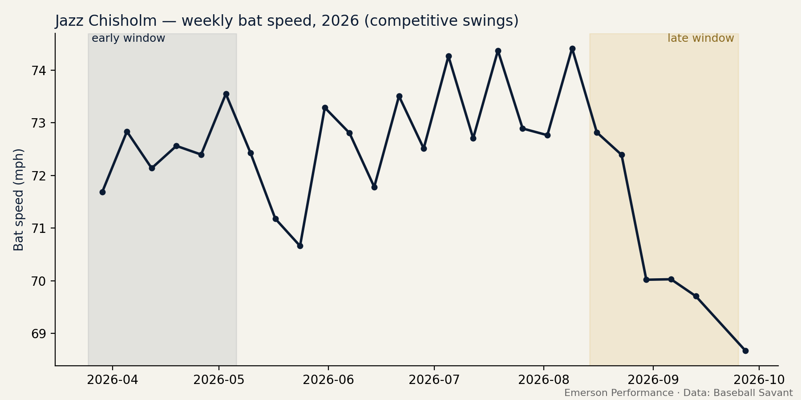

# Offseason Development Plan — Jazz Chisholm
*Emerson Performance (EP) · Emerson Jimenez*

## 1. Data / Datos
- Competitive swings: 222 early / 142 late
- Bat speed: 72.8 → 70.4 mph
- Swing length: 7.85 → 7.45 ft

## 2. Finding / Hallazgo — `CONFIRMED`
**EN:** Bat speed fell 2.4 mph from the first to the last 6 weeks (72.8 → 70.4 mph; Mann-Whitney BH-q = 6.94e-06, Cohen's d = 0.58).

**ES:** El bat speed bajó 2.4 mph entre las primeras y las últimas 6 semanas (72.8 → 70.4 mph; Mann-Whitney BH-q = 6.94e-06, d de Cohen = 0.58).

## 3. Biomechanics / Biomecánica — `INTERPRETATION`
**EN:** Bat speed dropped with a stable or shorter swing. Same path, less speed points to a drop in force/power production (lower-body and rotational).

**ES:** El bat speed bajó con un swing estable o más corto. Mismo recorrido con menos velocidad apunta a una caída en la producción de fuerza/potencia (tren inferior y rotacional).

## 4. Training application / Aplicación — profile: `force`
| Weeks | Phase / Fase | Work / Trabajo |
|---|---|---|
| 1-3 | General preparation / Restore / *Preparación general / Recuperación* | Hip and thoracic mobility circuit / *Circuito de movilidad de cadera y torácica* Eccentric-focused squat and RDL (3x8, 3-sec lowering) / *Sentadilla y RDL con énfasis excéntrico (3x8, bajada de 3 seg)* Anti-rotation core: Pallof press, dead bug / *Core anti-rotación: Pallof press, dead bug* Trap bar deadlift intro (3x6 @ moderate load) / *Introducción a peso muerto con trap bar (3x6 carga moderada)* |
| 4-7 | Maximal strength / *Fuerza máxima* | Trap bar deadlift (4x4-5) / *Peso muerto trap bar (4x4-5)* Rear-foot elevated split squat (3x6/side) / *Sentadilla búlgara (3x6 por lado)* Landmine rotational press (3x6/side) / *Press rotacional con landmine (3x6 por lado)* Extra strength set on main lifts (+1 set) / *Serie extra de fuerza en los ejercicios principales (+1 serie)* |
| 8-10 | Rotational power / *Potencia rotacional* | Rotational med ball scoop/shot-put throws (4x5/side, max intent) / *Lanzamientos rotacionales de balón medicinal (4x5 por lado, máxima intención)* Countermovement and broad jumps (4x3) / *Saltos con contramovimiento y horizontales (4x3)* Strength maintenance: main lifts at 2x3 / *Mantenimiento de fuerza: ejercicios principales 2x3* Heavier med ball (+1-2 kg) on half the sets / *Balón más pesado (+1-2 kg) en la mitad de las series* |
| 11-12 | Transfer and taper to spring training / *Transferencia y descarga hacia spring training* | Overload/underload bat work (coordinated with hitting coach) / *Trabajo con bates pesados/livianos (coordinado con el coach de bateo)* Reduce lifting volume ~40%, keep intensity / *Bajar volumen de pesas ~40%, mantener intensidad* Retest all monitoring metrics / *Repetir todas las pruebas de monitoreo* |

## 5. Monitoring / Monitoreo
- REQUIRED — Bat speed with a bat sensor in cage sessions (best of 5 swings) — every 2 weeks / *REQUERIDO — Bat speed con sensor de bate en la jaula (mejor de 5 swings) — cada 2 semanas*
- 2027 FOLLOW-UP — Statcast competitive-swing bat speed, first 6 weeks, vs the success threshold below / *SEGUIMIENTO 2027 — Bat speed de swings competitivos de Statcast, primeras 6 semanas, contra el umbral de éxito de abajo*
- RECOMMENDED — Rotational med ball throw and CMJ height (low-cost equipment): if bat speed does not improve, they show whether force improved but did not transfer to the swing / *RECOMENDADO — Balón medicinal rotacional y altura del CMJ (equipo de bajo costo): si el bat speed no mejora, muestran si la fuerza subió pero no se transfirió al swing*
- OPTIONAL — CMJ early-phase RFD (0-100 ms), only if the club has force plates / *OPCIONAL — RFD temprana del CMJ (0-100 ms), solo si el club tiene plataformas de fuerza*

### Success threshold / Umbral de éxito — natural rebound baseline
**EN:** Hitters with a confirmed decline recovered a median of +0.1 mph on their own (league-adjusted, n=21). For this 2.4 mph drop, the plan counts as successful only if recovery exceeds +0.6 mph (75th percentile of natural rebound).

**ES:** Los bateadores con caída confirmada recuperaron solos una mediana de +0.1 mph (ajustado por la liga, n=21). Para esta caída de 2.4 mph, el plan solo cuenta como éxito si la recuperación supera +0.6 mph (percentil 75 de la recuperación natural).

## Limitations / Limitaciones
- No access to the player's medical, workload or training history. The plan is a template to individualize after an in-person assessment.
- A bat speed decline can also come from approach changes (e.g., two-strike swings), minor injury, or mechanical changes. The data cannot separate these.
- *Sin acceso al historial médico, de carga ni de entrenamiento del jugador. El plan es una plantilla para individualizar tras una evaluación en persona.*
- *La caída también puede venir de cambios de enfoque (ej. swings con dos strikes), lesiones menores o cambios mecánicos. Los datos no separan estas causas.*

## Literature / Literatura
- Welch CM et al. (1995). Hitting a baseball: a biomechanical description. JOSPT 22(5):193-201.
- Szymanski DJ et al. (2007). Effect of twelve weeks of medicine ball training on high school baseball players. J Strength Cond Res 21(3):894-901.
- DeRenne C, Szymanski DJ (2009). Effects of baseball weighted implement training: a brief review. Strength Cond J 31(2):30-37.
- Haff GG, Nimphius S (2012). Training principles for power. Strength Cond J 34(6):2-12.
- Suchomel TJ, Nimphius S, Stone MH (2016). The importance of muscular strength in athletic performance. Sports Med 46(10):1419-1449.
- Claudino JG et al. (2017). The countermovement jump to monitor neuromuscular status: a meta-analysis. J Sci Med Sport 20(4):397-402.
